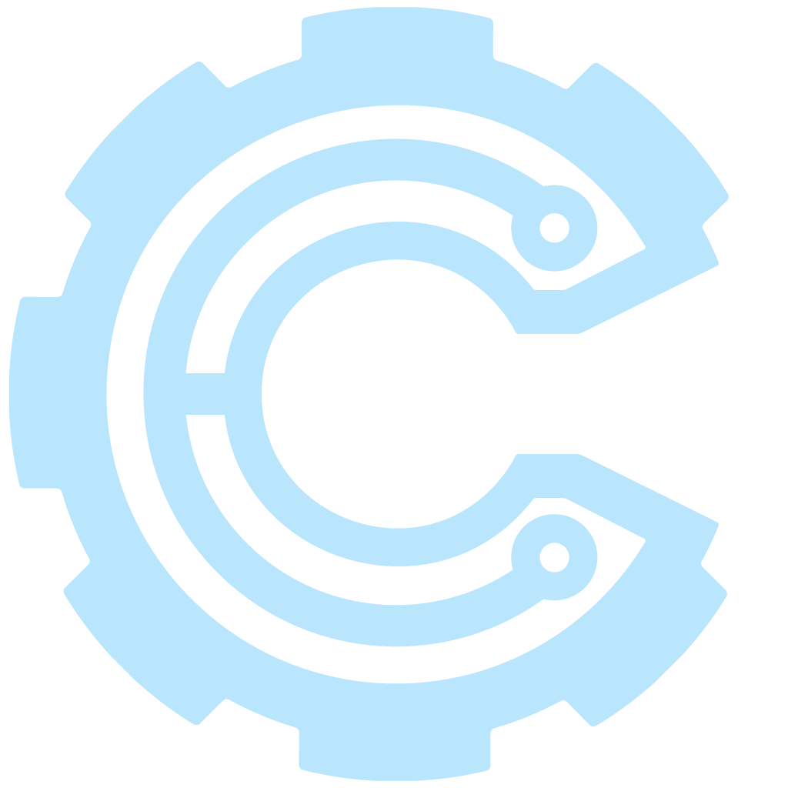

Cevexa connects your Discord guilds to Servers you manage from one
dashboard. These guides cover everything you can do as a user.

<CardGroup cols={2}>
  <Card title="Getting started" icon="rocket" href="/en/getting-started">
    Sign in with Discord and create your first Server.
  </Card>
  <Card title="Servers and Departments" icon="sitemap" href="/en/platform/domain-model">
    How Cevexa organizes communities.
  </Card>
  <Card title="Connect Discord" icon="discord" href="/en/platform/discord-integration">
    Link a guild: invite the bot and finish connecting.
  </Card>
  <Card title="Members and roles" icon="users" href="/en/members-and-roles">
    What owners, administrators and members can do.
  </Card>
  <Card title="FAQ" icon="circle-question" href="/en/faq">
    Common questions, answered.
  </Card>
  <Card title="Troubleshooting" icon="wrench" href="/en/troubleshooting">
    Fix missing guilds, stuck connections and error messages.
  </Card>
</CardGroup>

<CardGroup cols={2}>
  <Card title="Cevexa website" icon="globe" href="https://cevexa.xyz" />
  <Card title="Support" icon="discord" href="https://cevexa.xyz/discord" />
</CardGroup>
