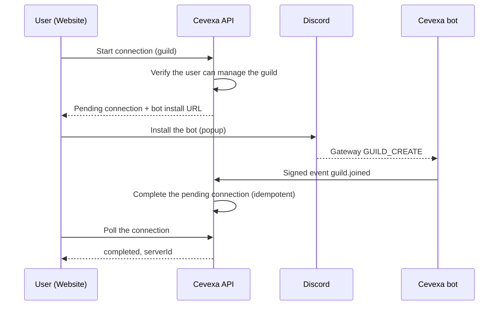

A Discord guild is connected to a Cevexa Server through a **pending connection**. The connection is completed only when both conditions are true:

1. The Cevexa user who started it can manage the guild. The API checks this with the guild list Discord returned during that user's Discord login (owner, `Administrator` or `Manage Server` permission). The guild list must be at most 24 hours old. Permissions sent by the browser are never trusted.
2. The Cevexa bot is present in the guild.

## Lifecycle



1. **Start.** The Website calls `POST /v1/discord/connections` (create a new Server from a guild) or `POST /v1/servers/{serverId}/integrations` (connect a guild to an existing Server or Department). Either route cancels the caller's earlier pending connections for the same guild, and connection creation is rate-limited per user.
2. **Install.** The response contains `installUrl`, which opens Discord's bot authorization for that guild. If the bot is already in the guild, the connection completes immediately.
3. **Verify.** The bot reports `guild.joined` to the API. The Website also polls `GET /v1/discord/connections/{connectionId}`; polling completes the connection as soon as the bot's installation is visible, so a delayed event does not block the user.
4. **Complete.** In one transaction the API creates the Server (for "Start with Discord"), adds the user as `owner`, and creates the `active` integration. Completing an already completed connection does nothing.

A pending connection expires after **15 minutes**. `DELETE /v1/discord/connections/{connectionId}` returns `204`: it cancels a `pending` connection and deletes a terminal (`failed`, `expired`, `cancelled`) one; an unknown id or another user's connection returns `404`. Expired or cancelled connections cannot be completed.

## Bot permissions

The bot is installed with the `bot` and `applications.commands` scopes and **no** guild permissions (`permissions=0`). The current bot only answers slash commands and component interactions, which do not need guild permissions. Future modules that need permissions will request them explicitly.

## Bot events

The Discord Gateway is handled by `Cevexa-Bot`. The bot never writes to PostgreSQL; it sends events to the API:

`POST /v1/internal/discord/events`

| Header | Value |
|---|---|
| `X-Cevexa-Timestamp` | Unix time in seconds |
| `X-Cevexa-Signature` | `sha256=` + hex HMAC-SHA256 of `{timestamp}.{raw body}` with `INTERNAL_EVENTS_SECRET` |

Requests whose timestamp is more than 5 minutes from server time — past or future — or whose signature is invalid are rejected with `401`.

```json
{
  "id": "guild.joined:123456789012345678:1731859200000",
  "type": "guild.joined",
  "guildId": "123456789012345678",
  "guildName": "My guild",
  "bot": "standard",
  "occurredAt": "2026-11-17T12:00:00Z"
}
```

The `bot` field is informational only: the API determines which Cevexa bot is installed in the guild from its own Redis sets (`bot:standard:guilds`, `bot:plus:guilds`), not from the event.

| Event | Effect |
|---|---|
| `guild.joined` | Completes the oldest pending connection for that guild — whoever started it — if one exists. Sets an existing `bot_missing` integration back to `active`. Without a pending connection or an existing integration, nothing is created. |
| `guild.left` | Sets the guild's integration to `bot_missing` — unless the other Cevexa bot (Standard vs Plus) is still installed in the guild, in which case it stays `active`. The Server and its members are not changed. |

Events are processed once per `id` (de-duplicated for 24 hours), so the bot can safely retry.

| Response | When |
|---|---|
| `200 { "ok": true }` | The event was processed |
| `200 { "duplicate": true }` | An event with this `id` was already accepted |
| `400 invalid_request` | Malformed JSON or an unknown event `type` |
| `400 validation_failed` | A required field is missing (for example `guildId`) |
| `401` | Invalid signature or a timestamp more than 5 minutes off |
| `503 service_unavailable` | The endpoint is disabled (no signing secret configured) |

The endpoint is also rate-limited per IP; a `429 rate_limited` response carries a `Retry-After` header.

## Disconnecting

`DELETE /v1/servers/{serverId}/integrations/{integrationId}` removes the integration. It does not remove the bot from the guild; a guild administrator removes the bot in Discord.
