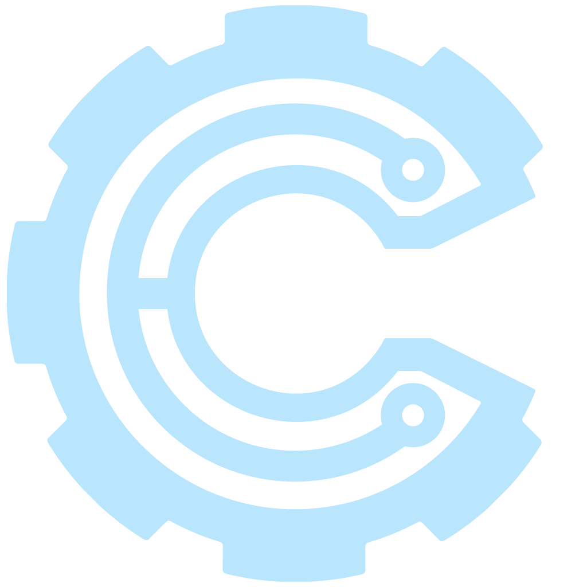

Cevexa связывает ваши Discord-гильдии с Серверами, которыми вы управляете из
одной панели. Эти руководства описывают всё, что доступно пользователю.

<CardGroup cols={2}>
  <Card title="Начало работы" icon="rocket" href="/ru/getting-started">
    Войдите через Discord и создайте первый Сервер.
  </Card>
  <Card title="Серверы и Отделы" icon="sitemap" href="/ru/platform/domain-model">
    Как Cevexa организует сообщества.
  </Card>
  <Card title="Подключение Discord" icon="discord" href="/ru/platform/discord-integration">
    Свяжите гильдию: добавьте бота и завершите подключение.
  </Card>
  <Card title="Участники и роли" icon="users" href="/ru/members-and-roles">
    Что могут владельцы, администраторы и участники.
  </Card>
  <Card title="Частые вопросы" icon="circle-question" href="/ru/faq">
    Ответы на распространённые вопросы.
  </Card>
  <Card title="Решение проблем" icon="wrench" href="/ru/troubleshooting">
    Пропавшие гильдии, зависшие подключения и ошибки.
  </Card>
</CardGroup>

<CardGroup cols={2}>
  <Card title="Сайт Cevexa" icon="globe" href="https://cevexa.xyz" />
  <Card title="Поддержка" icon="discord" href="https://cevexa.xyz/discord" />
</CardGroup>
