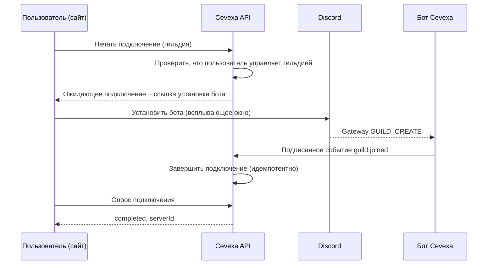

Гильдия Discord подключается к серверу Cevexa через **ожидающее подключение** (pending connection). Подключение завершается, только когда выполнены оба условия:

1. Пользователь Cevexa, который начал подключение, может управлять гильдией. API проверяет это по списку гильдий, который Discord вернул при входе этого пользователя через Discord (владелец, право `Administrator` или `Manage Server`). Список гильдий должен быть не старше 24 часов. Права, присланные браузером, никогда не принимаются на веру.
2. Бот Cevexa находится в гильдии.

## Жизненный цикл



1. **Старт.** Сайт вызывает `POST /v1/discord/connections` (создать новый сервер из гильдии) или `POST /v1/servers/{serverId}/integrations` (подключить гильдию к существующему серверу или департаменту). Оба маршрута отменяют предыдущие ожидающие подключения вызывающего к той же гильдии, а создание подключений ограничено по частоте запросов на пользователя.
2. **Установка.** Ответ содержит `installUrl` — страницу авторизации бота Discord для этой гильдии. Если бот уже в гильдии, подключение завершается сразу.
3. **Проверка.** Бот сообщает API о событии `guild.joined`. Сайт также опрашивает `GET /v1/discord/connections/{connectionId}`; опрос завершает подключение, как только установка бота становится видна, поэтому задержка события не блокирует пользователя.
4. **Завершение.** В одной транзакции API создаёт сервер (для «Начать с Discord»), добавляет пользователя как `owner` и создаёт интеграцию со статусом `active`. Повторное завершение уже завершённого подключения ничего не делает.

Ожидающее подключение истекает через **15 минут**. `DELETE /v1/discord/connections/{connectionId}` возвращает `204`: отменяет `pending`-подключение и удаляет финальное (`failed`, `expired`, `cancelled`); неизвестный id или чужое подключение возвращают `404`. Истёкшие и отменённые подключения завершить нельзя.

## Права бота

Бот устанавливается со scope `bot` и `applications.commands` и **без** прав в гильдии (`permissions=0`). Текущий бот только отвечает на слэш-команды и взаимодействия с компонентами, для этого права в гильдии не нужны. Будущие модули, которым нужны права, будут запрашивать их явно.

## События бота

Discord Gateway обрабатывает `Cevexa-Bot`. Бот никогда не пишет в PostgreSQL; он отправляет события в API:

`POST /v1/internal/discord/events`

| Заголовок | Значение |
|---|---|
| `X-Cevexa-Timestamp` | Unix-время в секундах |
| `X-Cevexa-Signature` | `sha256=` + hex HMAC-SHA256 от `{timestamp}.{тело запроса}` с ключом `INTERNAL_EVENTS_SECRET` |

Запросы, чья метка времени отличается от серверного времени более чем на 5 минут — в прошлое или в будущее, — или с неверной подписью отклоняются с кодом `401`.

```json
{
  "id": "guild.joined:123456789012345678:1731859200000",
  "type": "guild.joined",
  "guildId": "123456789012345678",
  "guildName": "My guild",
  "bot": "standard",
  "occurredAt": "2026-11-17T12:00:00Z"
}
```

Поле `bot` носит только информационный характер: API определяет, какой бот Cevexa установлен в гильдии, по собственным множествам в Redis (`bot:standard:guilds`, `bot:plus:guilds`), а не по событию.

| Событие | Результат |
|---|---|
| `guild.joined` | Завершает самое старое ожидающее подключение для этой гильдии — кем бы оно ни было начато, — если оно есть. Возвращает существующую интеграцию из `bot_missing` в `active`. Без ожидающего подключения или существующей интеграции ничего не создаётся. |
| `guild.left` | Переводит интеграцию гильдии в `bot_missing` — если второй бот Cevexa (Standard или Plus) всё ещё установлен в гильдии, статус остаётся `active`. Сервер и его участники не меняются. |

Каждое событие обрабатывается один раз по `id` (дедупликация на 24 часа), поэтому бот может безопасно повторять отправку.

| Ответ | Когда |
|---|---|
| `200 { "ok": true }` | Событие обработано |
| `200 { "duplicate": true }` | Событие с таким `id` уже принималось |
| `400 invalid_request` | Некорректный JSON или неизвестный `type` события |
| `400 validation_failed` | Отсутствует обязательное поле (например, `guildId`) |
| `401` | Неверная подпись или метка времени отличается более чем на 5 минут |
| `503 service_unavailable` | Эндпоинт отключён (секрет подписи не настроен) |

Эндпоинт также ограничен по частоте запросов на IP; ответ `429 rate_limited` содержит заголовок `Retry-After`.

## Отключение

`DELETE /v1/servers/{serverId}/integrations/{integrationId}` удаляет интеграцию. Бот при этом не удаляется из гильдии; его удаляет администратор гильдии в Discord.
